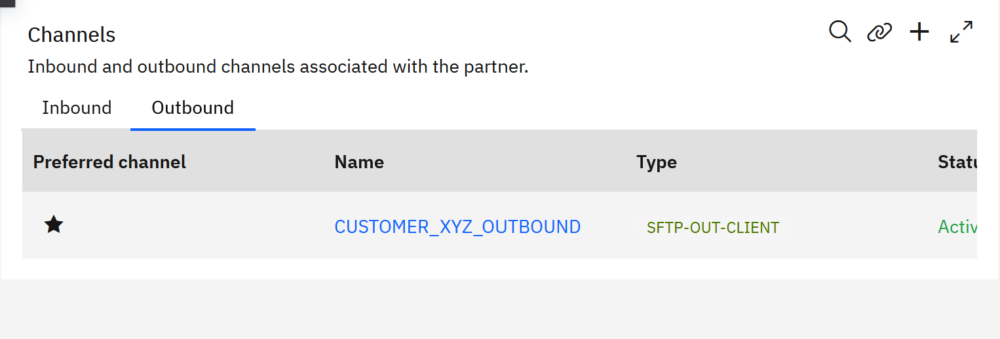
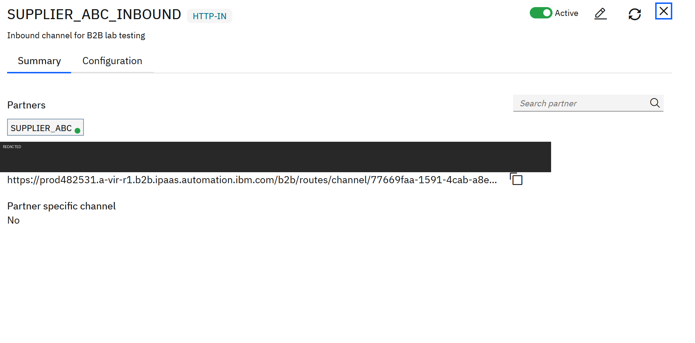
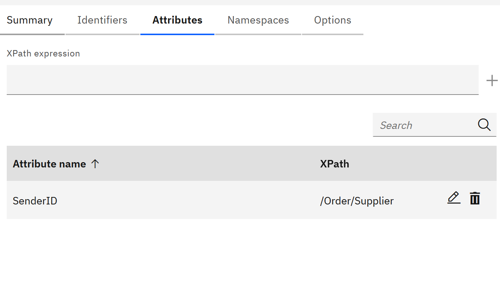
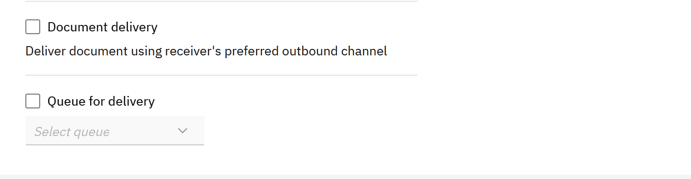
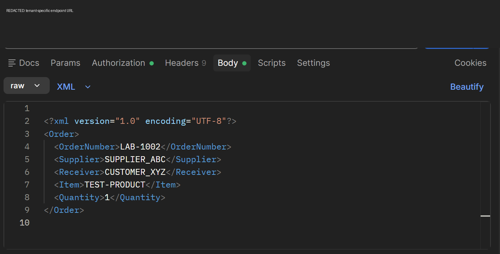
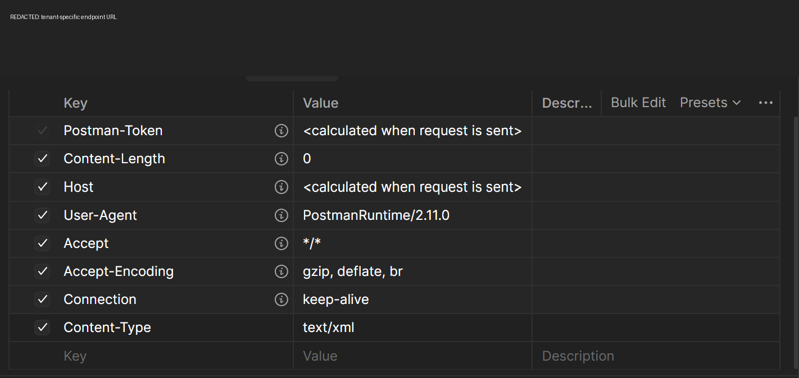
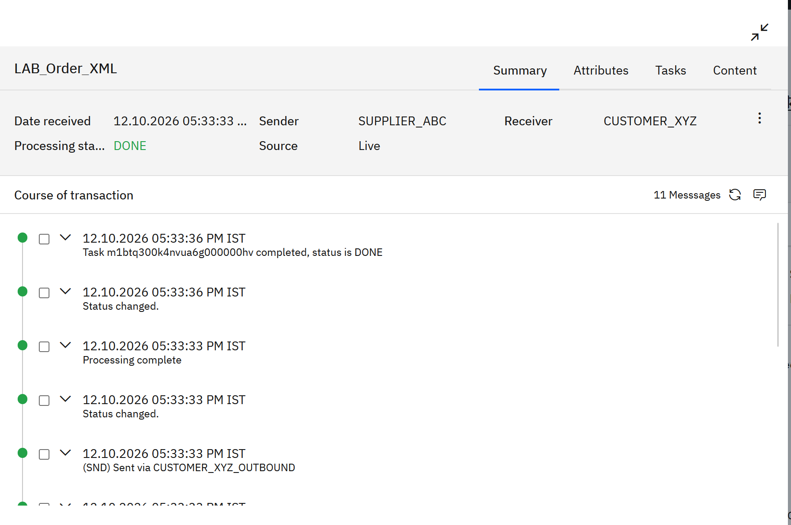

# Lab 1 — Partner Onboarding and XML-to-SFTP B2B Exchange

**Platform:** IBM webMethods B2B Integration (IWHI SaaS)  
**Level:** Beginner  
**Outcome:** Submit an XML order through an HTTP-IN endpoint, identify the sender and receiver, route the document, and deliver it through the receiver's preferred SFTP outbound channel.

> **Important before publishing:** This tutorial uses lab partner names. Replace tenant-specific endpoint URLs and all secrets with placeholders in any public repository. Never commit passwords, API tokens, SFTP credentials, or live endpoint URLs that should remain private.

## Learning objectives

By the end of this lab, you should be able to:

1. Create two partner profiles.
2. Configure a simple XML business document and map sender/receiver attributes.
3. Create a processing rule that delivers a document using the receiver's preferred outbound channel.
4. Configure an HTTP-IN channel for the supplier and an SFTP-OUT-CLIENT channel for the receiver.
5. submit XML from Postman and inspect the B2B transaction.
6. Verify outbound delivery in the SFTP test server.

## Architecture

```text
Postman
  |
  | HTTP POST + XML + Basic Auth
  v
SUPPLIER_ABC_INBOUND (HTTP-IN)
  |
  v
LAB_Order_XML + attribute extraction
  |
  v
LAB_SUPPLIER_ABC_XML_ROUTING
  |
  v
CUSTOMER_XYZ_OUTBOUND (SFTP-OUT-CLIENT, preferred)
  |
  v
SFTPCloud test destination
```

This lab simulates a supplier submitting an order into webMethods. It does not represent a live supplier system unless the supplier itself is configured to call the endpoint.

## Prerequisites

- Access to an IBM Integration SaaS Tenant - webMethods B2B Integration .
- Permission to create partners, channels, business documents, and processing rules.
- Postman installed locally.
- A test SFTP destination such as SFTPCloud, with host, port, username, password, and host-key handling configured.
- Two test partner identities:
  - `SUPPLIER_ABC`
  - `CUSTOMER_XYZ`

Do not copy the sample names or credentials into production without adapting them to the trading partners' agreed identities and security requirements.

## Lab configuration reference

| Object | Lab value |
|---|---|
| Supplier partner | `SUPPLIER_ABC` |
| Supplier identity type | `Mutually Defined` |
| Supplier identity value | `SUPPLIER_ABC` |
| Receiver partner | `CUSTOMER_XYZ` |
| Business document | `LAB_Order_XML` |
| Document root | `Order` |
| Sender attribute XPath | `/Order/Supplier` |
| Receiver attribute XPath | `/Order/Receiver` |
| Inbound channel | `SUPPLIER_ABC_INBOUND` (`HTTP-IN`) |
| Outbound channel | `CUSTOMER_XYZ_OUTBOUND` (`SFTP-OUT-CLIENT`) |
| Processing rule | `LAB_SUPPLIER_ABC_XML_ROUTING` |
| Test SFTP destination folder | `/` |
| Content-Type | `text/xml` |

The actual HTTP endpoint is tenant-specific. Copy it from the channel Summary page at runtime; do not hard-code a live endpoint in this public tutorial.

---

## Step 1 — Create the supplier partner

1. In webMethods B2B Integration, open **Connections → Manage partners** (the exact label may vary slightly by tenant UI).
2. Choose the option to add/onboard a partner.
3. Create partner `SUPPLIER_ABC`.
4. Add an identity:
   - **Identity type:** `Mutually Defined`
   - **Identity value:** `SUPPLIER_ABC`
5. Save the partner and ensure it is active.

The identity value is important: it must match the value that will be extracted from the incoming XML.

### Expected result

The partner profile exists and is active, with a `Mutually Defined` identity value of `SUPPLIER_ABC`.

## Step 2 — Create the receiving partner

1. Add a second partner named `CUSTOMER_XYZ`.
2. Add a `Mutually Defined` identity with value `CUSTOMER_XYZ`.
3. Save and activate the partner.

### Expected result

Both sender and receiver partner profiles exist. The XML's Supplier and Receiver values will be used to resolve these identities.

## Step 3 — Configure the receiver's SFTP outbound channel

1. Open the `CUSTOMER_XYZ` partner profile.
2. Open **Channels → Outbound** and add an outbound channel.
3. Select `SFTP-OUT-CLIENT`.
4. Enter the test SFTP server details supplied by your SFTP test service:
   - Host and port
   - Host public-key handling (use the approach approved for your environment)
   - Username and password
   - Destination folder `/` for this lab
5. Configure file naming as required for the test. In this lab the channel used the `wmiob2b` prefix and appended a timestamp.
6. Save and activate the channel.
7. Mark `CUSTOMER_XYZ_OUTBOUND` as the **preferred outbound channel** for `CUSTOMER_XYZ`.



### Expected result

`CUSTOMER_XYZ_OUTBOUND` appears as active and is marked as the preferred outbound channel.

**Security note:** Do not publish the SFTP hostname, username, password, private keys, or connection secrets if they identify a real account. Use a disposable lab server.

## Step 4 — Configure the supplier's HTTP-IN channel

1. Open **Connections → Channels**.
2. Add a channel of type `HTTP-IN` named `SUPPLIER_ABC_INBOUND`.
3. Associate it with `SUPPLIER_ABC` as required by the UI.
4. Activate the channel.
5. Open its **Summary** tab and copy the full **Endpoint URL** using the copy icon.



The endpoint is a tenant-specific URL. Paste it directly into Postman for your own tenant; do not paste the live URL into the public README.

### Communication credentials

The lab used an active communication credential associated with `SUPPLIER_ABC` (username `suppuser1` in the lab environment). The password was set during credential creation and is not recoverable from this tutorial.

If you do not know the password, create/reset a lab credential according to your tenant's supported workflow. Do not guess a password, and do not reuse an IBM account password. Confirm the endpoint's authentication requirements for your tenant before testing.

## Step 5 — Create the XML business document

1. Open **Assets → Business documents**.
2. Create a business document named `LAB_Order_XML`, type `XML`.
3. Set a description such as `Sample order XML document for SUPPLIER_ABC B2B lab testing`.
4. Define the XML structure with root `Order` and fields:
   - `OrderNumber`
   - `Supplier`
   - `Receiver`
   - `Item`
   - `Quantity`
5. Save and activate the business document.

### Configure attributes

Open the document's **Attributes** tab and configure:

| Attribute name | XPath expression |
|---|---|
| `SenderID` | `/Order/Supplier` |
| `ReceiverID` | `/Order/Receiver` |



Ensure the XPath names match the actual XML element names and capitalization. The values extracted by these mappings must resolve to partner identities. For this lab, `SUPPLIER_ABC` and `CUSTOMER_XYZ` are the expected values.

## Step 6 — Create the processing rule

1. Open the processing rules area.
2. Create and activate `LAB_SUPPLIER_ABC_XML_ROUTING`.
3. Set the rule to match the business document `LAB_Order_XML`.
4. Use sender/receiver criteria appropriate to the lab. The initial lab rule used **Any** for sender and receiver and matched the business document type.
5. Enable the **Document delivery** action.
6. Select the behavior that delivers the document using the receiver's preferred outbound channel.
7. Set the rule sequence so the intended rule is evaluated before the default rule, as supported by the UI.
8. Save and activate the rule.



### Expected result

The rule is active and includes the document-delivery action that uses the receiver's preferred outbound channel. Confirm the actual criteria and sequence in your tenant; the built-in Default rule can otherwise process a document first.

## Step 7 — Submit an XML order from Postman

1. Open Postman and create an HTTP request.
2. Set method to `POST`.
3. Paste the complete URL copied from `SUPPLIER_ABC_INBOUND`.
4. Open **Authorization** and select **Basic Auth** if required by the endpoint configuration. Use the active communication username and its configured password. Never put secrets in the URL or in a screenshot.
5. Open **Headers** and set:
   - `Content-Type` = `text/xml`
6. Open **Body → raw → XML**.
7. Paste the sample below. Use a unique order number for each submission.

```xml
<?xml version="1.0" encoding="UTF-8"?>
<Order>
  <OrderNumber>LAB-1004</OrderNumber>
  <Supplier>SUPPLIER_ABC</Supplier>
  <Receiver>CUSTOMER_XYZ</Receiver>
  <Item>TEST-PRODUCT-04</Item>
  <Quantity>2</Quantity>
</Order>
```





8. Click **Send**.
9. Record the HTTP status and response. An HTTP `200 OK` confirms the HTTP request was handled, but does **not by itself** prove that the B2B document was recognized, routed, or delivered.

### Expected result

Postman returns an HTTP response. Continue to Monitoring to confirm B2B processing and outbound delivery.

## Step 8 — Verify the B2B transaction

1. Open **Monitoring → Transactions**.
2. Refresh the list and open the newest transaction for your unique order number.
3. Review **Summary**, **Attributes**, and the **Course of transaction**.
4. Verify these expected fields:
   - Document type: `LAB_Order_XML`
   - Sender: `SUPPLIER_ABC`
   - Receiver: `CUSTOMER_XYZ`
   - Processing status: `DONE`
   - Course of transaction includes delivery via `CUSTOMER_XYZ_OUTBOUND`



### Important distinction

The lab encountered failed test transactions as well as a successful transaction. An earlier failure showed `Partner ID mismatch`, sender/receiver `Unknown`, and `ABORTED`. Do not treat `200 OK` alone as a successful B2B exchange. Use the transaction record and destination file to prove success.

## Step 9 — Verify the file in SFTPCloud

1. Open the SFTP test server's file browser or logs.
2. Browse the configured destination folder `/`.
3. Refresh the list or view the upload logs.
4. Look for the new upload generated at the time of your test. In this lab, the outbound channel used the `wmiob2b` prefix and appended a timestamp, so the resulting filename may not include the order number.
5. Confirm the upload event and file size/timestamp.

### Expected result

A new file appears in the configured SFTP destination, and the B2B transaction shows the send event through `CUSTOMER_XYZ_OUTBOUND`.

> The SFTP server is a test destination standing in for the customer's endpoint. This lab demonstrates outbound delivery to that server; it does not demonstrate a separate inbound SFTP pickup workflow.

---

## Troubleshooting

### HTTP response says `Access Denied`

- Check the HTTP status and response body.
- Confirm the request uses the authentication method configured for the endpoint.
- Verify that the communication credential is active and associated with the intended partner.
- Do not assume that an SFTP password is also the HTTP password.

### Transaction says `Partner ID mismatch`; sender is `Unknown`

- Check the `SenderID` mapping points to `/Order/Supplier`.
- Check the XML contains `<Supplier>SUPPLIER_ABC</Supplier>`.
- Confirm the partner identity type/value match the transformation/lookup configuration.
- Verify the authenticated communication credential is associated with the intended supplier.
- Inspect the transaction's course of transaction and attributes before changing configuration.

### Receiver is `Unknown`

- Check the `ReceiverID` mapping points to `/Order/Receiver`.
- Check the XML contains `<Receiver>CUSTOMER_XYZ</Receiver>`.
- Confirm `CUSTOMER_XYZ` has a matching identity and that the mapping/lookup resolves that identity.

### Document Type is `Unknown`

- Confirm the business document is active.
- Verify the XML root element is `Order` and matches the configured document schema.
- Check the transaction content and the endpoint's supported content/document-recognition requirements.
- Do not assume that `Content-Type` alone guarantees document recognition.

### Transaction is `DONE` but no file appears

- Confirm `CUSTOMER_XYZ_OUTBOUND` is active and preferred.
- Confirm the processing rule's document-delivery action is active and the intended rule matched.
- Review the course of transaction for a send event.
- Check the configured SFTP destination folder and SFTP server logs.
- Confirm the timestamped filename and refresh the file browser.

### HTTP `200 OK`, but transaction is aborted

HTTP success and B2B processing success are different layers. Inspect the transaction status and error details. Fix the underlying identity, document recognition, or routing issue rather than repeatedly resending the same payload.

## Completion checklist

- [ ] `SUPPLIER_ABC` partner is active and has the expected identity.
- [ ] `CUSTOMER_XYZ` partner is active and has the expected identity.
- [ ] `SUPPLIER_ABC_INBOUND` HTTP-IN channel is active.
- [ ] `CUSTOMER_XYZ_OUTBOUND` SFTP-OUT-CLIENT channel is active and preferred.
- [ ] `LAB_Order_XML` is active and contains the `Order` schema.
- [ ] `SenderID` and `ReceiverID` XPath mappings are correct.
- [ ] `LAB_SUPPLIER_ABC_XML_ROUTING` is active and delivers using the receiver's preferred outbound channel.
- [ ] Postman request has the correct endpoint, authentication, `Content-Type`, and XML body.
- [ ] Transaction shows resolved sender/receiver and status `DONE`.
- [ ] A new file is visible in the SFTP destination or its upload logs.

## Suggested next lab

**Lab 2 — X12 EDI 850 Purchase Order Exchange**

Build on this XML exercise by defining/recognizing an X12 850 Purchase Order, understanding the envelope and partner identification requirements, submitting a test EDI document, and tracing it through B2B processing. Before implementing, verify which EDI document standards and tooling are available in your IWHI SaaS tenant.

## Official documentation

- [IBM webMethods B2B Integration documentation](https://www.ibm.com/docs/en/wm-b2b)
- [Sharing inbound channel endpoint details](https://www.ibm.com/docs/en/wm-b2b?topic=channels-sharing-inbound-channel-endpoint-details)
- [Creating a channel](https://www.ibm.com/docs/en/wm-b2b?topic=channels-creating-channel)

---

*Tutorial version: 1.0 — based on the lab configuration and screenshots captured during the October 12, 2026 hands-on session. UI labels and supported options may vary by tenant release.*
