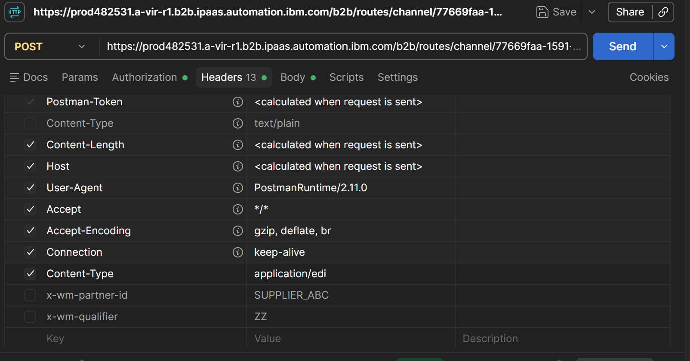

# Lab 02 --- Send an X12 4010 850 Purchase Order to SFTPCloud

## Objective

Send an X12 4010 850 EDI purchase order from Postman to IBM webMethods
B2B Integration SaaS (IWHI), have B2B process the inbound document, and
verify that the outbound file reaches SFTPCloud.

This lab reuses the partner profiles and SFTP destination established in
Lab 01.

## End-to-end flow

``` text
Postman
  |
  | POST X12 850
  | Content-Type: application/edi
  v
SUPPLIER_ABC_INBOUND (HTTP-IN)
  |
  v
B2B EDI document identification and processing rule
  |
  | CUSTOMER_XYZ_OUTBOUND
  v
SFTPCloud
```

## Prerequisites

-   Access to an IBM webMethods B2B Integration SaaS tenant.
-   Partner profiles already created:
    -   Sender: `SUPPLIER_ABC`
    -   Receiver: `CUSTOMER_XYZ`
-   An active inbound HTTP-IN channel named `SUPPLIER_ABC_INBOUND`
    associated with `SUPPLIER_ABC`.
-   The endpoint URL for `SUPPLIER_ABC_INBOUND`.
-   Communication credentials for `SUPPLIER_ABC` (the lab used username
    `suppuser1`).
-   An active outbound SFTP channel for `CUSTOMER_XYZ` that connects to
    your SFTPCloud test server.
-   The X12 4010 850 business document type available in the tenant.
-   An active processing rule for the lab, configured for sender
    `SUPPLIER_ABC`, receiver `CUSTOMER_XYZ`, and business document
    `X12 4010 850`, with delivery through the receiver's preferred
    outbound channel.
-   Postman installed and access to the SFTPCloud test account.

> **Security:** Do not commit passwords, tokens, tenant secrets, or
> private endpoint credentials to GitHub. Use your own tenant's endpoint
> and credentials.

## Configuration summary

  ------------------------------------------------------------------------
  Item                                Value used in this lab
  ----------------------------------- ------------------------------------
  Sender partner                      `SUPPLIER_ABC`

  Receiver partner                    `CUSTOMER_XYZ`

  Inbound channel                     `SUPPLIER_ABC_INBOUND` (HTTP-IN)

  Business document                   `X12 4010 850`

  Processing rule                     `LAB_SUPPLIER_ABC_X12_850_ROUTING`

  Outbound channel                    `CUSTOMER_XYZ_OUTBOUND` (SFTP)

  Postman method                      `POST`

  Working Content-Type                `application/edi`

  Authentication                      Basic Auth using the sender's
                                      communication credential
  ------------------------------------------------------------------------

## Step 1 --- Verify the B2B configuration

Before testing, confirm the following in your tenant:

1.  `SUPPLIER_ABC` has the inbound HTTP-IN channel
    `SUPPLIER_ABC_INBOUND`.
2.  The channel is active and its endpoint URL is available.
3.  `CUSTOMER_XYZ` has an active outbound SFTP channel connected to
    SFTPCloud.
4.  The EDI business document `X12 4010 850` is available.
5.  `LAB_SUPPLIER_ABC_X12_850_ROUTING` is active and has the intended
    sender, receiver, and business-document criteria.
6.  The rule delivers using `CUSTOMER_XYZ_OUTBOUND` or the receiver's
    preferred outbound channel, according to your tenant's
    configuration.

Do not create a second inbound channel just to make this test work. The
original channel was successful once the correct Content-Type was used.

## Step 2 --- Create the Postman request

1.  Create or open a request in Postman.
2.  Set the method to **POST**.
3.  Paste the endpoint URL copied from the active `SUPPLIER_ABC_INBOUND`
    channel.
4.  Open **Authorization** and select **Basic Auth**.
5.  Enter the username and password for the communication credential
    associated with `SUPPLIER_ABC`. In this lab, the username is
    `suppuser1`.
6.  Open **Body**.
7.  Select **raw** and choose **Text** from the format dropdown.
8.  Paste the sample X12 message from
    [`sample-files/x12-850.edi`](sample-files/x12-850.edi).

### Important: Content-Type

Open **Headers** and ensure that the only enabled `Content-Type` header
is:

``` text
Content-Type: application/edi
```

If a `Content-Type: text/plain` row exists, leave it disabled. The
successful test used `application/edi`; using `application/edi-x12`
resulted in the document being classified as `Unknown` in this tenant.

The optional `x-wm-partner-id` and `x-wm-qualifier` headers were not
required for the successful test and can remain disabled.



## Step 3 --- Send the X12 850 message

Use this sample message. Keep each EDI segment together on one line in
the request body; the editor may visually wrap long lines.

``` edi
ISA*00*          *00*          *ZZ*SUPPLIER_ABC   *ZZ*CUSTOMER_XYZ   *261016*1800*U*00401*000000006*0*T*:~
GS*PO*SUPPLIER_ABC*CUSTOMER_XYZ*20261016*1800*6*X*004010~
ST*850*0006~
BEG*00*SA*LAB850-1006**20261016~
CUR*BY*USD~
REF*DP*LAB2~
N1*ST*CUSTOMER XYZ~
N1*SU*SUPPLIER ABC~
PO1*1*2*EA*25.00**BP*TEST-PRODUCT-01~
PID*F****EDI LAB TEST PRODUCT~
CTT*1~
SE*10*0006~
GE*1*6~
IEA*1*000000006~
```

The same payload is available in
[`sample-files/x12-850.edi`](sample-files/x12-850.edi).

Click **Send**.

### Expected HTTP result

Postman should return **`200 OK`** for the successful request.


A `200 OK` confirms the HTTP request was accepted; it is not, by itself,
proof that the EDI document was routed and delivered. Continue with the
monitoring and SFTP checks below.

## Step 4 --- Verify the transaction in B2B Monitoring

1.  Open B2B **Monitoring**.
2.  Find the newest transaction by its received timestamp.
3.  Open the transaction and inspect the summary, attributes, and
    transaction events.
4.  Confirm that the sender/document identification and processing
    details are consistent with the X12 850 test.
5.  Inspect the routing-rule event. The intended lab rule is
    `LAB_SUPPLIER_ABC_X12_850_ROUTING`.

During troubleshooting, this tenant initially showed
`Document Type: Unknown` and `Routing rule Default rule selected`. The
successful fix was changing the Postman Content-Type to
`application/edi`. If `Unknown` or the Default rule still appears, first
verify the exact Content-Type and that the request is using the intended
active channel.


## Step 5 --- Verify delivery in SFTPCloud

1.  Sign in to the SFTPCloud test server used by
    `CUSTOMER_XYZ_OUTBOUND`.
2.  Open the destination directory configured for the outbound channel.
3.  Refresh the file list.
4.  Confirm that a new file arrived after the Postman request.
5.  If needed, compare its timestamp with the B2B Monitoring transaction
    timestamp.

In this lab run, the user confirmed that the file appeared in SFTPCloud.
The filename and destination directory may differ according to the SFTP
channel configuration.

## Troubleshooting

  --------------------------------------------------------------------------
  Symptom                                What to check
  -------------------------------------- -----------------------------------
  HTTP `403 Forbidden` with a message    Verify the Basic Auth credential is
  that the partner is posing as          associated with the sender partner
  `Unknown`                              and that the request uses the
                                         correct inbound endpoint.

  Monitoring shows                       Set the enabled header to
  `Document Type: Unknown`               `Content-Type: application/edi`;
                                         ensure `text/plain` is disabled and
                                         the body contains the raw X12
                                         message.

  Monitoring says                        Check document identification
  `Routing rule Default rule selected`   first, then verify sender,
                                         receiver, business-document
                                         criteria, and rule activation.

  Postman returns `200 OK`, but no file  Check B2B transaction events and
  is visible                             delivery-task status, confirm the
                                         outbound SFTP channel and
                                         destination folder, and refresh
                                         SFTPCloud.

  Duplicate `Content-Type` headers       Keep one enabled `Content-Type`
                                         header only.

  SFTP delivery fails                    Verify the outbound channel's
                                         connection details, credentials,
                                         destination path, and
                                         transport-task error.
  --------------------------------------------------------------------------

## Validation checklist

-   [ ] Postman uses the original active `SUPPLIER_ABC_INBOUND`
    endpoint.
-   [ ] Authorization uses the sender's communication credential.
-   [ ] Body is raw text containing the X12 850 message.
-   [ ] Only one enabled `Content-Type` header is present, set to
    `application/edi`.
-   [ ] Postman returns `200 OK`.
-   [ ] B2B Monitoring shows the transaction and the expected
    processing/routing outcome.
-   [ ] The new outbound file is visible in SFTPCloud.

## What you learned

-   How to submit an X12 4010 850 purchase order to a webMethods B2B
    HTTP-IN endpoint using Postman.
-   Why the HTTP `Content-Type` matters when B2B identifies an inbound
    EDI document.
-   How to trace the transaction through B2B Monitoring.
-   How to validate the end-to-end outcome by checking the SFTPCloud
    destination.

## Repository placement

Place this lab under:

``` text
webmethods-zero-to-hero/
└── webMethods-B2B/
    └── Lab-02-X12-EDI-850/
        ├── README.md
        ├── sample-files/
        │   └── x12-850.edi
        └── screenshots/
            ├── postman-working-headers.png
            ├── postman-x12-850-body-200-ok.png
            └── monitoring-default-rule-diagnostic.png
```
